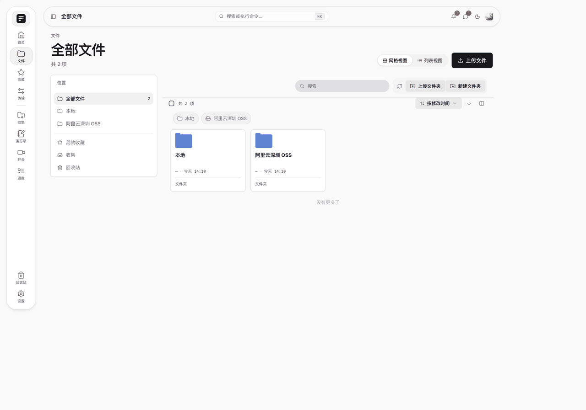
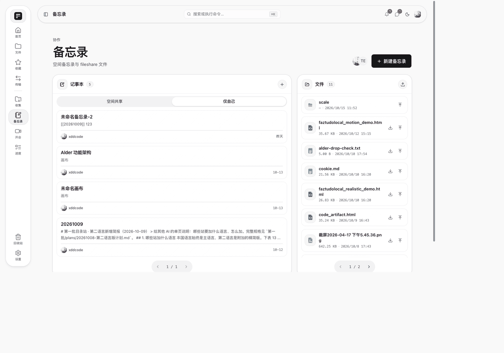
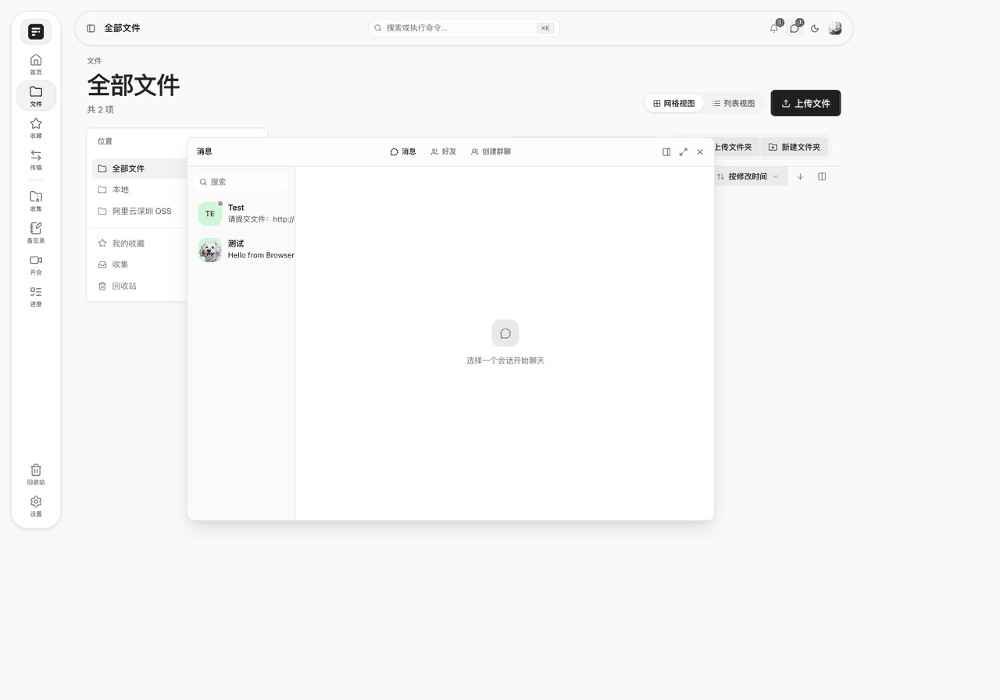
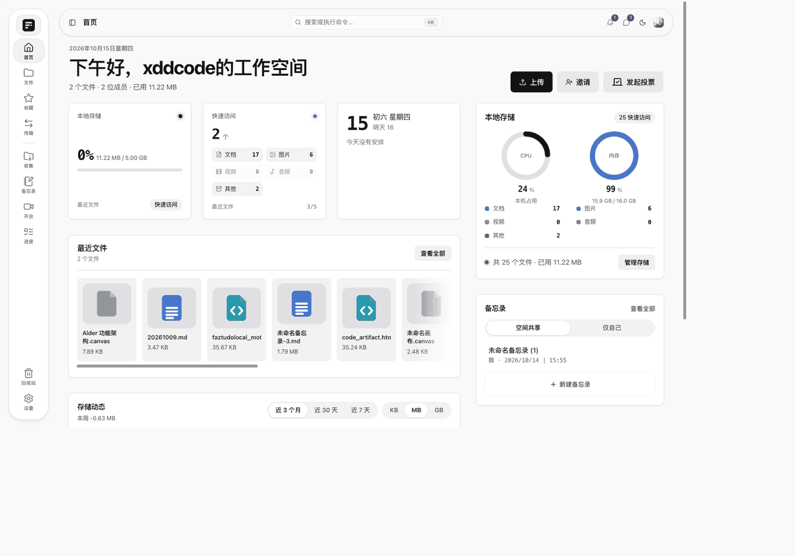
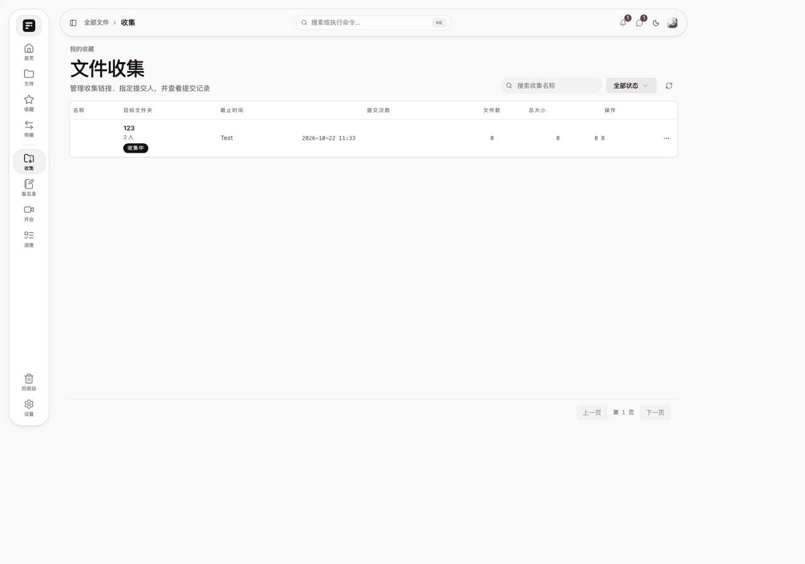
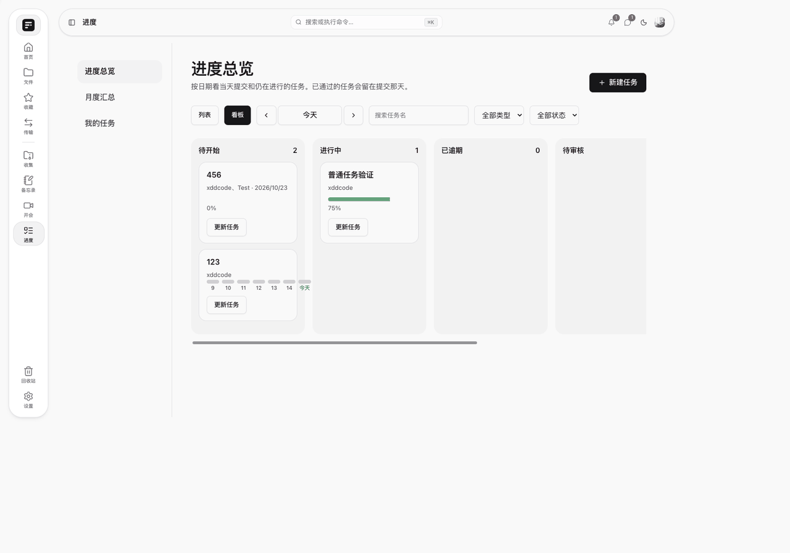
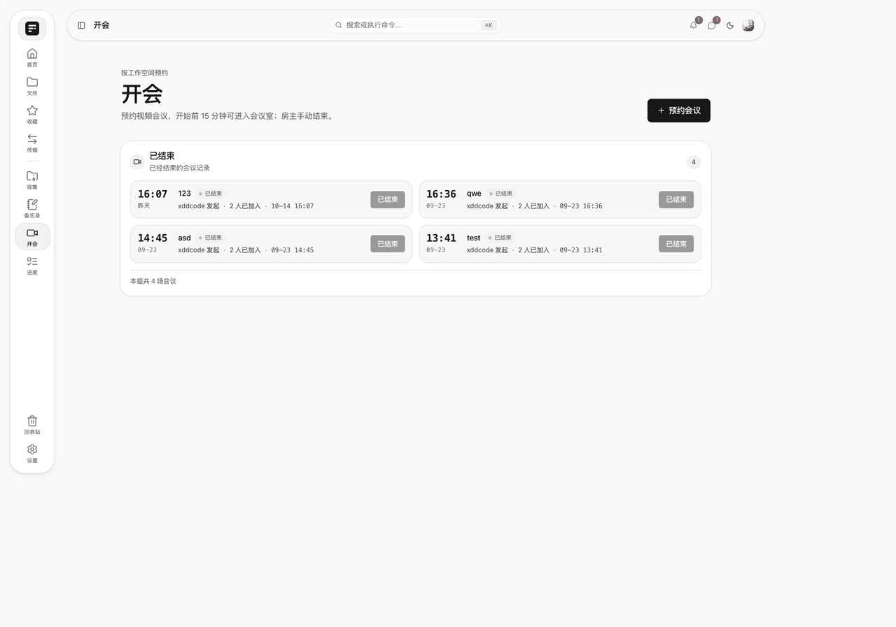
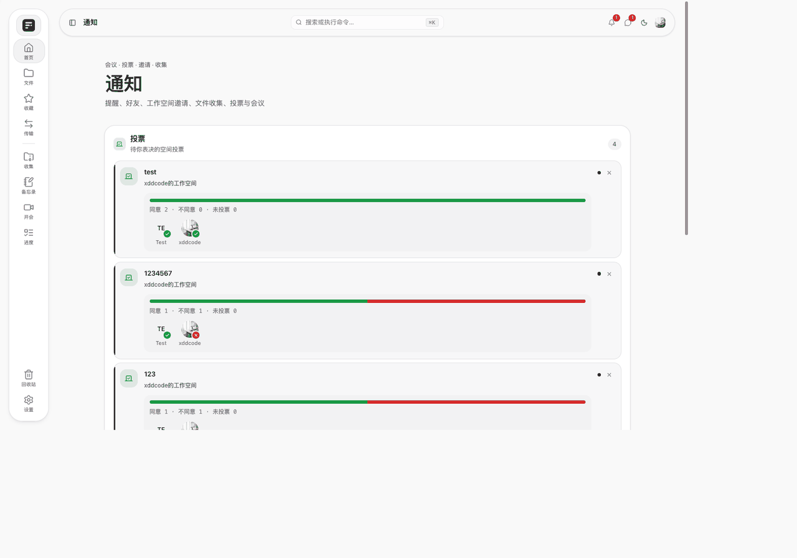
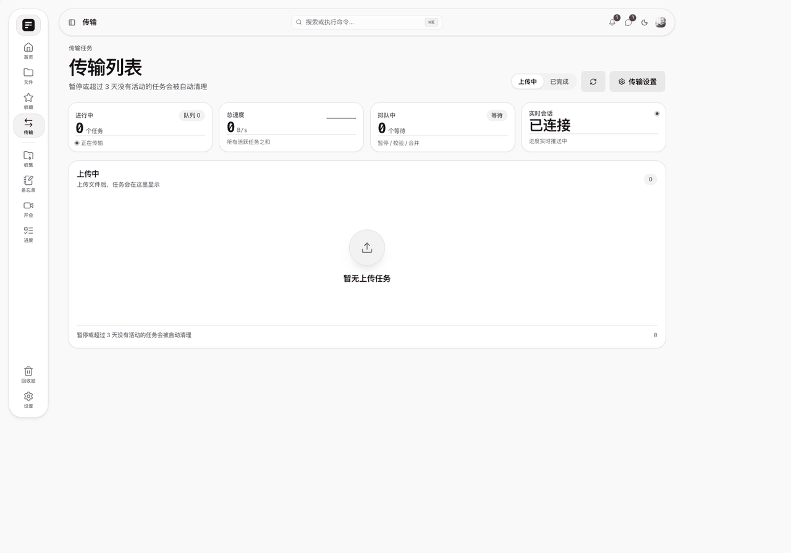

<div align="center">


# Alder

**ローカルワークステーション · Beta v0.1**

ファイル、メモ、チャットを一台に。ドラッグすればつながる。

[Free-FS](https://github.com/dromara/free-fs) を改変。[Apache License 2.0](LICENSE)。帰属は [NOTICE](NOTICE)。

[中文](README.md) · [繁體](README.zh-Hant.md) · [English](README.en.md) · [Français](README.fr.md) · [Русский](README.ru.md)

</div>

Alder は**ローカルのワークステーション**です。一台（または Docker Compose 一式）でサイト全体を回し、同じ事務所や自宅で使います。公開クラウドのネットディスクではありません。いまは **Beta v0.1** で、API と画面はまだ変わります。

核はひとつです。**ワークスペース・メモ・チャットは、同じ材料への三つの入口**です。いったん落として上げ直す必要はありません。

<div align="center">

</div>

## ワークスペース

空間ごとにファイル、メンバー、役割、ストレージがあります。既定はローカルディスク。オブジェクトストレージ（MinIO / OSS / COS など S3 互換）は空間単位で隔離され、空間を切り替えると見えません。

グリッドまたはリスト。二画面で突き合わせてドラッグできます。同じ内容は秒で通り、ローカルは Tus で再開します。画像、Office、音声・動画はページ内プレビューです。

<div align="center">

</div>

## メモ

左がメモ、右がその空間共有の `fileshare` 列。両方のあいだでドラッグします。空間のファイルをメモに入れると**参照カード**になり、複製はしません。カードを開くとファイルの場所に戻ります。手元のファイルは先に列へ上がってから参照になります。

共同編集は Yjs、オンラインの更新は SSE です。あとからファイルを消すと、カードは無効と表示され、空白は開きません。

<div align="center">

</div>

## チャット

会話はどのページにも浮かぶ窓です。ファイル庫を閉じずに、空間のファイルを会話へ（同じ実体のまま）、会話のファイルをフォルダへ**コピー**できます。会話のファイルをメモへ落とすと、先に `fileshare` へコピーされ、参照カードになります。

一対一、グループ、引用、取り消し、既読。本文は端末内だけの鍵でエンドツーエンド暗号化します。

<div align="center">

</div>

ドラッグの意味：

| から | へ | 実際に起きること |
| --- | --- | --- |
| ワークスペースのファイル | メモ | 参照カード。複製しない |
| ワークスペースのファイル | 会話 | すでに空間にあるそのファイルを送る |
| 会話のファイル | ワークスペース | ポインタ下のフォルダへコピー |
| 会話のファイル | メモ | 先に列へコピーし、参照カードにする |
| パソコンのファイル | メモ | 列へアップロードしてからメモへ置く |

## そのほか

<div align="center">

</div>

| | | |
| --- | --- | --- |
| **ホームとカレンダー** | 分類、最近のファイル、容量。大きな日付、旧暦、祝日。個人予定は空間に縛られない。 |  |
| **収集** | 指定メンバーへのリンク。指定フォルダへ届く。知らせはベルで、チャットには出ない。 |  |
| **進捗** | 通常タスクと毎日の打刻。ボード / 一覧 / 月次。写真は `fileshare/scale`。完了後は審査待ち。 |  |
| **会議** | 空間ごとに予約。15 分前に開室。ホワイトボード、マイク、複数カメラ、画面共有は一人。P2P、だめなら TURN。 |  |
| **通知と投票** | 招待、収集、投票、会議をベルで処理。閉じた知らせは繰り返し出ない。 |  |
| **転送** | 進捗、一時停止、再開。同じ網の友人は LAN 直送でき、オブジェクトストレージを通さない。 |  |
| **共有** | リンクと取出コード。受け取ったファイルを自分の空間へ保存できる。 | |
| **サイト設定** | メール、ドメイン、CORS、ローカルパス、TURN。秘密は再表示しない。暗号化 `alder-site.box` を書き出せる。 | |

画面の言語：簡体中国語、繁体中国語、英語。

## 配備（ローカルワークステーション）

[Docker](https://docs.docker.com/get-docker/) と Docker Compose が必要です。初回は JDK / Node のベースイメージを取るので数分かかります。

```bash
git clone <このリポジトリ> alder && cd alder
docker compose up -d --build
```

**http://localhost** を開きます。API は `http://localhost:8080`（文書は `/swagger-ui.html`）。

データは二つのボリュームです。`alder-pg`（PostgreSQL）と `alder-files`（ローカルアップロード）。コンテナを止めても消えません。

```bash
docker compose logs -f gateway
docker compose down          # 停止。ボリュームは残す
docker compose down -v       # 停止し、DB とローカルファイルを消す
```

Compose の既定ユーザは `alder` / `alder` で、閉じた LAN 向けです。外に出す前にパスワードと JWT を変え、設定 → サイト設定でメールと CORS を入れてください。網をまたぐ会議には自分の TURN が要ります。

Docker を使わず手元で動かす場合：JDK 21、Maven、PostgreSQL、Redis、Node.js。`application.example.yml` と `application-dev.example.yml` を `.example` なしの名前へコピーし、`Gateway` だけ起動（`-am` は付けない）。フロントは `npm run dev` で既定 `http://localhost:5180`。

## ライセンス

[Apache License 2.0](LICENSE) で公開しています。

Alder は [Free-FS](https://github.com/dromara/free-fs)（xddcode と dromara コミュニティ）の派生物であり、公式リリースではありません。Apache 2.0 第 4 条に従い上流の表示を残しています。帰属の全文は [NOTICE](NOTICE) です。
